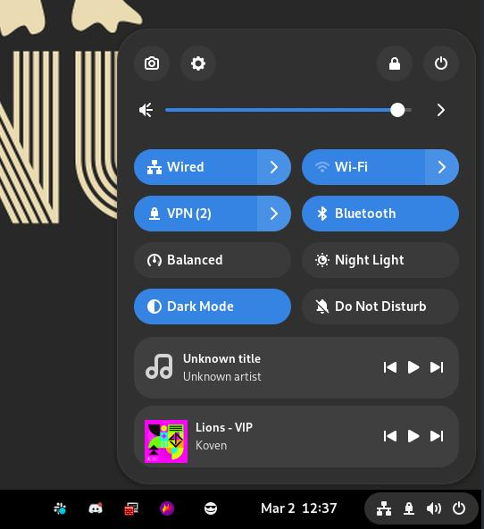

import MPRISConfig from '@site/../config/mpris.json.example?raw';
import ENVConfig from "@site/src/content/docs/configuration/sources/_env_configs/_mpris.md";

[MPRIS](https://specifications.freedesktop.org/mpris-spec/latest) is a standard interface for communicating with Music Players on **linux operating systems.**

If you run Linux and have a notification tray that shows what media you are listening to, you likely have access to MPRIS.



multi-scrobbler can listen to this interface and scrobble tracks played by **any media player** that communicates to the operating system with MPRIS.

##### Host Setup

MPRIS communication requires multi-scrobbler to have access to the host's dbus-daemon.

<Tabs groupId="dbus" queryString>
    <TabItem value="local" label="Local">
        If multi-scrobbler is running as a [**Local Installation**](/installation/#nodejs), directly with node/npm, on the same host as MPRIS then no setup is required.

        Remote setup is also possible, see the **Remote Unix Socket** section in the Docker tab.
    </TabItem>
    <TabItem value="docker" label="Docker">
        If multi-scrobbler is running as a [**Docker Container**](/installation/#docker) some modifications are required...

        ##### Local Unix Socket

        The most secure way is to **run a multi-scrobbler container on the same host as MPRIS.** In this scenario you can simply mount the **user session** dbus unix socket into the container. Make sure [`PUID` and `PGID` ENVs are configured](/installation?dockerSetting=linuxHost#recommended-settings) so the container has permissions to access the socket. Then, modify your compose stack with these additional values:

        ```yaml title="docker-compose.yaml" placeholder="UID"

            environment:
            - DBUS_SESSION_BUS_ADDRESS=unix:path=/run/user/UID/bus 

            volumes:
            - /run/user/UID/bus:/run/user/UID/bus:ro
        ```

        ##### Remote Unix Socket

        <Aside type="warning">


        This method is **insecure.** You should not expose dbus over a network unless access to the port is restricted and the network is trusted.


        </Aside>

        Use [`socat`](https://linux.die.net/man/1/socat) to bidirectionally relay communication from the host's dbus socket to a listening TCP port.

        To make dbus for user with uid `1000` available on port `6644`:

        ```shell
        socat TCP-LISTEN:6644,reuseaddr,fork UNIX-CONNECT:/run/user/1000/bus
        ```

        Then, add the following value to multi-scrobbler's ENVs:

        ```text placeholder="yourHostIP"
        DBUS_SESSION_BUS_ADDRESS=tcp:host=yourHostIP,port=6644
        ```

    </TabItem>
</Tabs>

## Configuration

<Config config="MPRISSourceConfig" fileContent={MPRISConfig} name="mpris">
<ENVConfig/>
</Config>