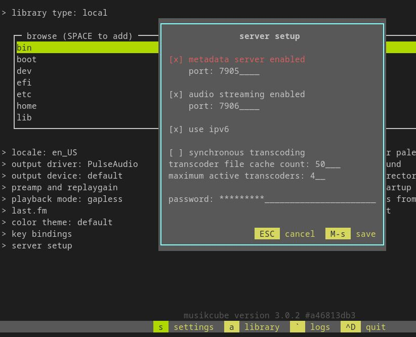

import MusikcubeConfig from '@site/../config/musikcube.json.example?raw';
import ENVConfig from "@site/src/content/docs/configuration/sources/_env_configs/_musikcube.md";

In order to use [Musikcube](https://musikcube.com) configure it to accept [websocket connections](https://github.com/clangen/musikcube/wiki/remote-api-documentation) in **server setup**:

* Enable the **Metadata Server**
* Set a **Password**

Both of these settings are found in _Musikcube -> (s)ettings -> server setup_



The URL used by MS has the syntax:

```
[ws|wss]://HOST:[PORT]
```

The **port** is the same as shown in the server setup screenshot from above, under **metadata server enabled**. If no port is provided to MS it will default to `7905`.

If no URL is provided to MS it will try to use `ws://localhost:7905`

## Configuration

<Config config="MusikcubeSourceConfig" fileContent={MusikcubeConfig} name="musikcube">
<ENVConfig/>
</Config>