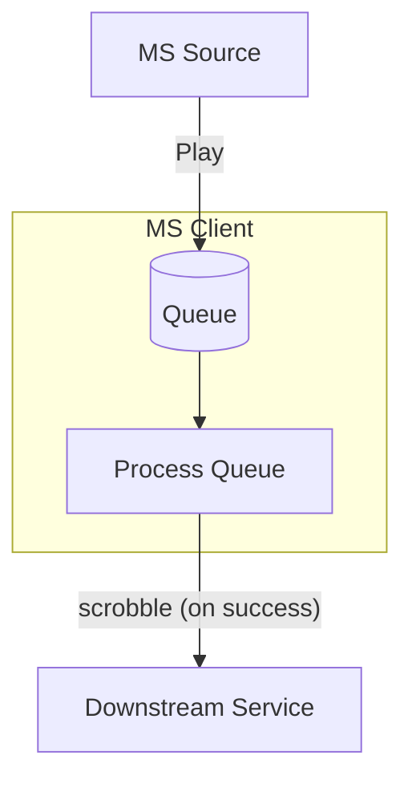
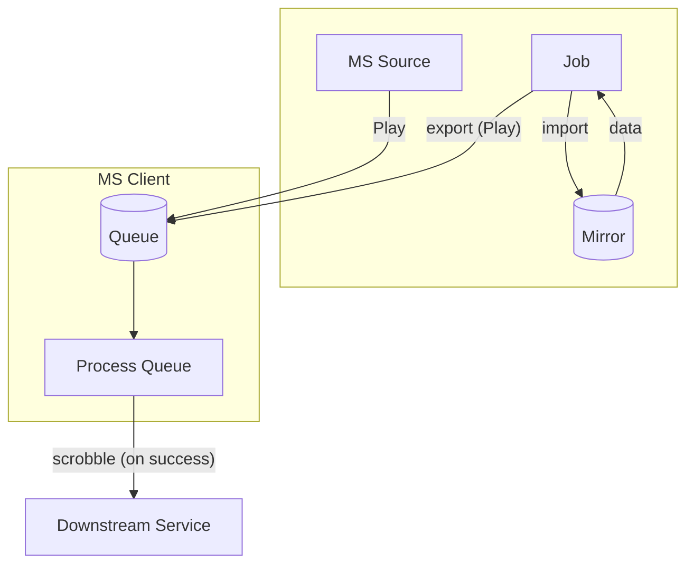

import { Badge } from '@astrojs/starlight/components';

Multi-Scrobbler can bulk import your Play (scrobble) history and export it to your [Clients](/configuration/clients).

This page takes you through one example from start to end. You import your Last.fm history, export it to a Client, and then clean up. Each step explains the parts of Multi-Scrobbler that it uses.

## 1. Create a Job

A **Job** is the task that moves your Plays. A Job has two parts:

* An **Import**. It adds Plays to a Mirror.
* An optional **Export**. It sends the Plays in that Mirror to one or more Clients.

Each part runs on its own. You can pause, stop, and resume each part, so you can do the work at your own pace.

To start, open **Menu -> Import/Export** on the Dashboard and select **New Job**.

## 2. Import Your Plays into a Mirror

A **Mirror** is a saved copy of your Play history in the Multi-Scrobbler database. Jobs always export from a Mirror.

In the **Import** section:

1. In **Import From**, select where your Plays come from. For this example, select your Last.fm Source/Client, or upload a [file](#import-from-a-file).
2. In **Mirror**, select **New mirror** and give it a name.
3. In **Range**, keep **Everything**, or select **Between dates** to import part of your history.

The Mirror records the date range that each import covers. You can see these ranges on the Mirror's page (**Menu -> Mirrors**) after it is created.

<details>

<summary>Skipped plays on Job page</summary>

On the **Job** page, **skipped** is the number of imported Plays that were not added to the Mirror. The Mirror already had them, or they were exact duplicates (same second, artist and track) in the import.

</details>

<Aside type="note">

Only Last.fm data sources are available now because of the [API key deadline](/configuration/clients/lastfm). More sources will come later.

</Aside>

## 3. Export to a Client

In the **Export** section, select the Clients that get the Plays. Each Client exports separately and has its own progress and controls.

Exported Plays go through a Client [the same way as live scrobbles.](#job-client-interaction)

The Client always skips Plays that Multi-Scrobbler already sent to it. Because of this, you can export the same Plays two times without duplicates on the service.

You can also set [**Transforms**](/configuration/transforms) for the Job. They modify Play data before they go to each Client, the same as a [`postCompare` hook](/configuration/transforms/#hook) on a Source. You can apply transforms from an existing Source/Client or use a [preset](/configuration/transforms#presets). Be aware that exports are only as fast the [slowest transform](#transforms).

A Stage in the Job's Transforms can also tell the Job to skip a Play, or to add it to the Client in the **Needs Review** state. See [Play State Control in Import/Export Jobs](/configuration/transforms#play-state-control-jobs).

Once the Job is created, exporting to a Client occurs depending on the **Order** you set:

* Newest first - Exporting happens as new Plays are added to the Mirror
* Oldest first - Exporting only starts after the date range is fully imported

<Aside type="caution">

Do not export old history to **Last.fm** or **Libre.fm**. They refuse Plays older than about 14 days.

</Aside>

:::tip

The Export is optional. You can create an import-only Job now and export the Mirror later with a new Job.

:::

## 4. Start the Job and Watch It

Select **Create**. The Job page shows the progress of the Import and of each Client's Export.

You can **Pause**, **Stop**, and **Resume** each part from the Job page.

If the server restarts while a job is running, it resumes automatically. The job continues from the last saved position instead of starting over.

The [Scrobble Interval](/configuration/clients/#scrobble-interval) of a Client sets the export speed. The default is one Play each second. Lower it in the Client's configuration to export faster.

The duplicate check against the Client's service also slows large exports. You can turn it off on the Job page while the Export runs. See [Duplicate Checks](#duplicate-checks).

Exported Plays do not show in a Client's Play list by default. To see them, turn on **Plays from Export jobs** in the list filters.

## 5. Reuse and Add to a Mirror

Mirror are persisent; they are not deleted after a Job finishes. You can use a Miror again in new Jobs:

* To send the same history to another Client, create a Job, select the Mirror using **Existing Mirror**, and add the Client in **Export**.
* To add more history, create a Job that imports into the same Mirror.

A Mirror can hold Plays from different sources. You decide which sources and ranges go together.

<details>

<summary>For example...</summary>

Your Plays from 2008 to 2012 exist only on Last.fm, and a file has your Plays from 2013 onward. Import the file into a Mirror. Then import Last.fm into the same Mirror with a **Range** of 2008 to 2012. The Mirror exports both as one history.

</details>

Only one Job at a time can import into a Mirror.

<DetailsAdmo summary="Handling Plays Already in the Mirror">

When you import into a Mirror that already has Plays, select what happens where the date ranges overlap:

* **Keep** (default): Multi-Scrobbler keeps the Plays already in the Mirror and skips new Plays in those dates.
* **Replace**: Multi-Scrobbler deletes all Plays in the Mirror in the Job's date range, then imports the new Plays.

<Aside type="caution">

Replace deletes every Play in the Job's date range. It does not compare Plays one by one.

</Aside>

</DetailsAdmo>

## 6. Clean Up

Imported Plays, and the records that Clients keep of exported Plays, use disk space. When your exports finish, you can clean them up:

* **Compact** removes the raw data and transform details of each Play. The Plays stay.
* **Delete** removes the Plays.

Plays that a Client already sent stay on its service. Cleanup changes only what Multi-Scrobbler keeps in its database. A cleanup cannot start while an import or export that uses the same Plays is running.

You can clean up in three places:

<Tabs groupId="cleanupPlace">
<TabItem value="job" label="Job">

The **Clean Up** section of a Job page. It cleans up the Mirror Plays in the Job's range and the Plays the Job sent to each Client. If you **Delete** the Job, it asks what to do with the same Plays.

</TabItem>
<TabItem value="mirror" label="Mirror">

The Mirror page. You can clean up a date range or delete the whole Mirror. (You should delete the Mirror's Jobs first.)

</TabItem>
<TabItem value="client" label="Client">

The **Job Plays** section of a Client page. It cleans up all Plays that Jobs exported to that Client.

</TabItem>
</Tabs>

Other Jobs can use the same Mirror. A Mirror cleanup affects all of them.

## More Details

### Understanding Job Exports and Clients Interaction {#job-client-interaction}

It's important to understand that Jobs, when exporting, *only* ever interact with Multi-Scrobbler's [Client](/configuration/clients) *entity* and not the downstream service itself.

<details>

<summary>What's the difference?</summary>

* Client (Multi-Scrobbler) - The "[Koito](/configuration/clients/koito)" representation within MS. Responsible for queueing Plays, processing them, and then scrobbling *downstream* to the (actual service)
  * It keeps Plays it has seen/processed in the MS database
* Client (actual service) - The literal Koito instance that that the Client (Multi-Scrobbler) scrobbles to.

</details>

The Job "exports" Plays to the Client *within multi-scrobbler* by adding Plays to the Client's queue. This is the extent of a Job's interaction with Clients.

After a Play is added to the Client's queue it goes through the same processing any Play from a [Source](/configuration/sources) would go through, including the Client's own Transforms, duplicate checks, etc..

*So, when a Job mentions exporting to a "Client" or that plays were skipped being sent to a "Client" it means the Client **within Multi-Scrobbler**.*

<DetailsAdmo summary="Simplified Walkthrough and Visualization">

The (simplified) Job export process works like this:

1. Job pulls page Y containing X number of Plays from its [Mirror](#2-import-your-plays-into-a-mirror) and iterates them:
2. Checks a Play to see if exists in the *Multi-Scrobbler database* for *Client (Multi-Scrobbler)*. If it exists then it skipped being exported
3. If it does not exist in MS database then it "Exports" this Play by sending it to the queue for *Client (Multi-Scrobbler)*
4. Move to the next Play, repeat 2-4
5. When its runs out of Plays in page Y, go back to 1.

<Tabs groupId="jobExportFlowchart">
<TabItem value="normal" label="Normal Play Flow">

Visually, this is the normal Play/Scrobble flow (not a Job) from a Source to a *Client (Multi-Scrobbler)* to the downstream *(actual service) Client*



</TabItem>
<TabItem value="jobExport" label="Play in Job Export">

Visually, this is the same normal Play/Scrobble flow but it also shows how a Job processes and exports Plays to a *Client (Multi-Scrobbler)*



</TabItem>
</Tabs>


</DetailsAdmo>

### Import from a File

Multi-Scrobbler accepts files from these export tools:

| Exporter | Format | Notes |
|---|---|---|
| [lastfm.ghan.nl](https://lastfm.ghan.nl/export/) | JSON or CSV | Recommended. Timestamps to the second, and MusicBrainz IDs are kept. |
| [benjaminbenben](https://benjaminbenben.com/lastfm-to-csv/) | CSV | Timestamps only to the minute. See the note below. |

<DetailsAdmo type="note" summary="benjaminbenben files">

Multi-Scrobbler cannot match minute-only timestamps reliably against other sources. If a benjaminbenben file overlaps other Plays in the Mirror, use **Replace** for that range, or import it into a Mirror of its own. If you do not, the same Plays can be in the Mirror two times.

</DetailsAdmo>

You can add a file in two ways:

<Tabs groupId="uploadFileMethod">
<TabItem value="ui" label="Upload">

Upload the file in the **Import** section of **New Job**.

<DetailsAdmo type="note" summary="Max Upload Size">

A reverse proxy in front of Multi-Scrobbler can refuse large uploads. For example, nginx refuses request bodies over 1 MB by default. Raise its limit for Multi-Scrobbler:

```nginx
client_max_body_size 2g;
```

Or put the file in the imports folder. See the **Imports Folder** tab.

</DetailsAdmo>

</TabItem>
<TabItem value="folder" label="Imports Folder">

Put the file in the `imports` folder of the [data directory](/installation#persistent-directories). Then select **File in imports folder** in the Job.

* If you did not set `DATA_DIR`, use `CONFIG_DIR/imports`. Make the folder if it does not exist.
* If you set `DATA_DIR`, use `DATA_DIR/imports`.

Multi-Scrobbler never deletes files in this folder. Only one Job can use each file.

</TabItem>
</Tabs>

### Data Issues

Imported history can have Plays that look invalid. Multi-Scrobbler finds two kinds:

* **Bad timestamp**: the Play is dated before 2 Jan 1970, or in the future.
* **Burst**: the same track 3 or more times in a row, each within 2 seconds of the last.

The **Data Issues** section of a Mirror page lists these Plays. If a Job's range has some, the Job page shows a notice. The Mirror keeps all Plays as they are imported.

<details>

<summary>How Multi-Scrobbler finds these Plays</summary>

* A bad timestamp is before 2 Jan 1970 (UTC), or more than one day after the import. Last.fm changes Plays that originally had no date to have the date **1 Jan 1970**. A Play dated in the future comes from a wrong clock or a broken source.
* Real repeat listens are a track length apart. Bursts are often fake Plays that were added to carry over a play count from another player.

</details>

#### Skipping Data Issues

By default, an export sends all Plays. To leave some out, change the **Data Issues** options in the **Export** section of the Job. You can change them on the Job page at any time. A change applies to the Plays that the Job exports next.

**Skip bad timestamps**: the export does not send Plays with a bad timestamp.

**Bursts**: select one of these.

<Tabs groupId="burstMode">
<TabItem value="send" label="Send them as they are">

This is the default. The export sends every Play of each burst.

</TabItem>
<TabItem value="collapse" label="One Play per burst">

The export sends one Play of each burst. With this option, the export waits until the import is finished.

<details>

<summary>Which Play is sent, and why the export waits</summary>

The export sends the first Play of the burst in the export order. This is the newest Play for **Newest first**, and the oldest for **Oldest first**. If **Skip bad timestamps** is also on, it sends the first Play without a bad timestamp.

While an import runs, part of a burst can be missing from the Mirror. Then the export would send all of the Plays that are there. Plays that are sent cannot be taken back.

</details>

</TabItem>
<TabItem value="keepEpoch" label="One Play per burst, keep bursts before 1970">

Use this option if you copied play counts from older software into Last.fm when you started to use it. These Plays are bursts dated on 1 Jan 1970. The export sends these bursts whole, and one Play of each other burst.

The export sends bursts before 1970 without a duplicate check. So, before it sends them, the export looks for scrobbles before 1970 in each Client. If a Client has some, the export waits. On the Job page, select one of these for that Client:

* **Send anyway**: the export sends the Plays before 1970. Plays that the service already has are sent again.
  * <Badge text="Warning" size="small" variant="caution" /> This is essentially "YOLO, ignore all checks and send it." Re-exporting the same data again, or using another mirror with duplicate data, sent to the same client will absolutely result in duplicates
* **Skip Plays before 1970**: the export does not send Plays before 1970 to that Client.

:::caution
Some services do not accept Plays dated in 1970. Each of these Plays then fails, and the export stops after too many failures in a row.
:::

<details>

<summary>More about this option</summary>

* The Plays of a burst look like duplicates of each other. A service can also have too many Plays near 1 Jan 1970 to compare. This is why these Plays get no duplicate check.
* If **Skip bad timestamps** is also on, the export still skips Plays before 2 Jan 1970 that are not in a burst.
* Koito cannot find a scrobble dated at exactly 00:00:00 on 1 Jan 1970, you will need to use this option for this scenario

</details>

</TabItem>
</Tabs>

On the Job page, each Client shows how many Plays these options did not send.

<Aside type="tip">

If you are not sure that your data is good, import first and export after you look at it:

1. Create a Job with **Start now** off.
2. Start the import from the Job page.
3. When the import is finished, look at **Data Issues** on the Mirror page.
4. Set the Data Issues options on the Job page. Then start the exports.

</Aside>

### Failed Plays

If many exported Plays fail in a row, the Export stops and shows the last error. The limit is 10, or the Queue Limit if it is higher. This usually means that the Client configuration is wrong or its service is down. Fix the problem, then select **Resume**.

<details>

<summary>Retrying failed Job Plays</summary>

Multi-Scrobbler does not retry failed Plays from a Job by itself. To retry them, do one of these:

* On the Client page, turn on **Plays from Export jobs** in the **Plays** filters. Set **Played Between** to the Job's range. Then select **Retry All Unsuccessful** in the menu next to **Plays**.
* Create a new Job with the same Mirror and export to the Client again. The Client sends the failed Plays and skips the Plays it already has.

</details>

### Export Speed

The rate at which Plays are exported from a Job is shown for each Client on the Jobs page. This speed is dependent on several factors, some of which you may need to tune.

Click on **Show Metrics** in the client Export panel to see a detailed breakdown of processing metrics.

<DetailsAdmo type="tip" summary="Diagnosing Slow Exports">

If an Export is slower than you expect, collect its metrics before you open an issue:

1. On the Job page, in the **Export** section, select **Show metrics**.
2. Select the copy button. It copies the metrics as JSON.
3. Add the JSON to your issue.

The metrics show the time that each step of the Export takes, for example reading the Mirror, the duplicate checks, and the requests to the Client's service. The times cover the last 10 minutes, so copy them while the Export is slow. Select **Refresh** to get new values.

The same timings are also available from the [Prometheus endpoint](/configuration#prometheus) as `multiscrobbler_export_stage_seconds`, `multiscrobbler_export_wait_seconds`, and `multiscrobbler_play_stage_seconds`.

</DetailsAdmo>

The below sections detail behavior and options that can affect the export rate for a Job:

<DetailsAdmo summary="Transforms">

Multi-Scrobbler exports Plays one at a time. [Transforms](/configuration/transforms) that call external services (MusicBrainz, Rocksky) wait for each call. If you use Transforms and the metric **Process in the Client** (shown under **Show Metrics**) is a large contributor to timing metrics this may indicate Transforms are slowing down your export.

</DetailsAdmo>

<DetailsAdmo summary="Duplicate Checks">

Before a Client sends a Play, it compares the Play against two lists:

* The Plays that Multi-Scrobbler already sent to that Client. These are in the Multi-Scrobbler database, so this check is fast.
* The scrobbles on the Client's service. The Client fetches them from the service, so this check is slow for large exports.

The setting **Check downstream services for duplicates** controls the second list. It is on by default. If you clear it, the Client uses only the database list, and the Export rate will be much faster.

You can change the setting in two places:

* When you create the Job, in the **Advanced** settings of the **Export** section.
* On the Job page, in the **Export** section. You can change it while the Export runs.

A change applies to the Plays that the Export sends next. Plays that are already in the Client's queue keep the old setting. The queue holds up to the Job's **Queue Limit** of Plays.

<Aside type="caution">

Be careful when disabling this setting if the service has scrobbles in the Job's range that did not come from Multi-Scrobbler. You will be relying on the scrobble service's own checks to detect a duplicate which may not be as robust as Multi-Scrobblers and could result in duplicates being stored downstream.

</Aside>

</DetailsAdmo>

<DetailsAdmo summary="Downstream Client Scrobble Processing">

Some Clients, like Koito, do extra processing when you send a scrobble request. This extra processing can be a significant contributor to how fast, or slow, the scrobble request response is.

If export speed is important for you and [**Request to the service**](#export-speed) shown in the **Show Metrics** toggle is the majority of the processing time then you should attempt to tune your downstream client to reduce scrobble request response time.

<details>

<summary>Tuning Services</summary>

<Tabs groupId="exportServiceTuning">
<TabItem value="koito" label="Koito">

Set [these ENVs in the Koito container](https://koito.io/reference/configuration/):

* `KOITO_DISABLE_MUSICBRAINZ=true`
* `KOITO_DISABLE_COVER_ART_ARCHIVE=true`
* `KOITO_DISABLE_DEEZER=true`
* `KOITO_FETCH_IMAGES_DURING_IMPORT=true`

You should be aware that this effectively disables any track/artist/album corrections Koito would normally do when ingesting scrobbles. Only disable these if you are OK with scrobbles being recorded as-is, in Kotio.

</TabItem>
</Tabs>


</details>

</DetailsAdmo>

### Rate Limits

The [Teal.fm](/configuration/clients/tealfm#configuration) and [Rocksky](/configuration/clients/rocksky#configuration) Clients write to your PDS. Your PDS has a rate limit for each account, and a large Export can use all of it. Then your other apps, for example Bluesky, cannot write to your account.

These Clients keep a reserve of points free. When the reserve is reached, the Export waits until the limit resets. You can see the points that are used in the Export section of the Job page.